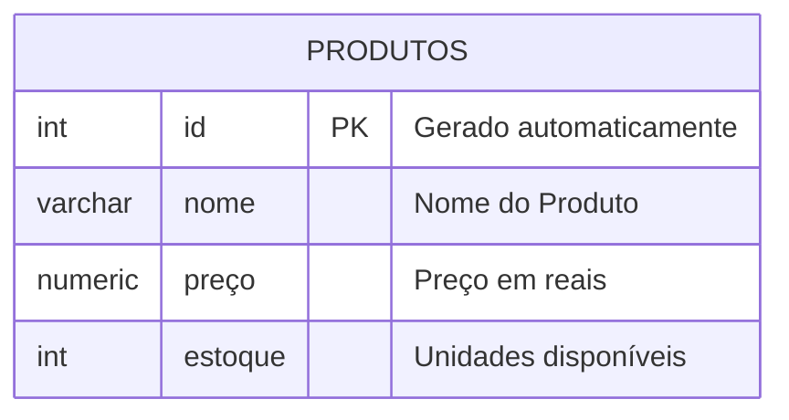
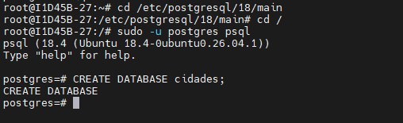
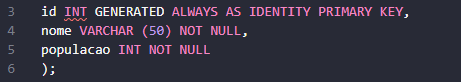
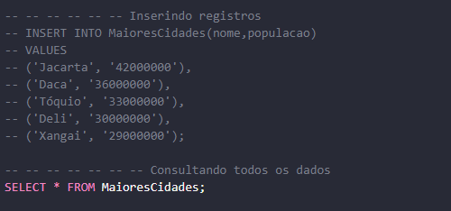
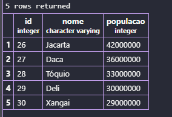

#### Aula 04
Comando para apagar um banco de dados:

```sql
DROP DATABASE lojamax
```
---
O objetivo é crir uma loja para aprender os principais comandos SQL.



Para criar a tabela, utilizamos os comados abaixo:
```sql
CREATE TABLE produtos(
    id INT GENERATED ALWAYS AS IDENTITY PRIMARY KEY, 
    nome VARCHAR (50) NOT NULL,
    preco NUMERIC(10,2) NOT NULL,
    estoque INT NOT NULL DEFAULT 0
);
```
Para inserir dados na tabela, utilizei os comandos abaixo: 
```sql
INSERT INTO produtos(nome,preco,estoque)
VALUES('iPHONE 17', '10000.00', '15');
```

#### Criação e edição do primeiro banco de dados
#### Passo 1 - Criar um Banco de Dados 
 

#### Passo 2 - Criar uma tabela chamada "MaioresCidades"


#### Passo 3 - Adicionar como, colunas: id, nome, populacao


#### Passo 4 - Inserir registros das 5 maiores cidades do mundo 


#### Passo 5 - -Consultar os 5 registros


