## Aula 05
Para filtrar colunas, utilizamos o comando;

```sql
SELECT nome,preço FROM produtos;
```

Para filtro de registros, utilizamos o comando:

```sql
SELECT * FROM produtos WHERE estoque < 10;
```
Para ordenar os dados:
```sql
SELECT nome,populacao FROM maiorescidades;
ORDER BY populacao DESC;
```

---

**UPDATE**; Update ou Delete sem `WHERE` Atinge TODAS as linhas! Não existe Ctrl+Z :(

Fluxo seguro (sempre):
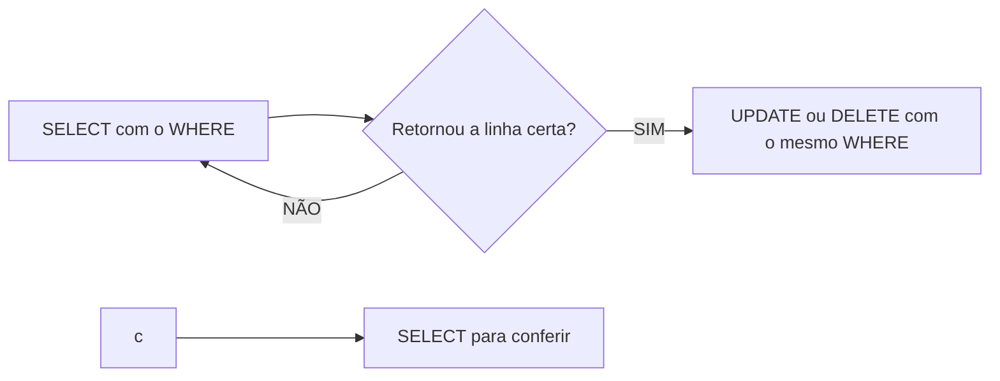
Para UPDATE:
```SQL
UPDATE maiorescidades
SET populacao=1000
WHERE nome='Jacarta';
``` 
---
Também é posssivel realizar cálculos:
```sql
UPDATE maiorescidades
SET populacao = populacao - 50
WHERE id = 2;
```

-- -- -- Criar uma tabela com Filmes e Séries (30 registros):
-- -- -- CREATE TABLE streaming(

-- -- -- id INT GENERATED ALWAYS AS IDENTITY PRIMARY KEY,
-- -- -- nome VARCHAR (50) NOT NULL,
-- -- -- duracao INT NOT NULL,
-- -- -- nota NUMERIC(10) NOT NULL
-- -- -- );

-- -- INSERT INTO streaming(nome,duracao,nota)
-- -- VALUES
-- -- ('Para Todos os Garotos que Já Amei', '99', '9'),
-- -- ('Para Todos os Garotos: P.S. Ainda Amo Você', '101', '7'),
-- -- ('Para Todos os Garotos: Para Sempre', '116', '8'),
-- -- ('Avatar', '177', '8'),
-- -- ('Avatar 2', '192', '8'),
-- -- ('Avatar 3', '195', '7'),
-- -- ('Enrolados', '100', '8'),
-- -- ('Aculpa é das Estrelas', '126', '8'),
-- -- ('Ela é Demais', '88', '3'),
-- -- ('As Branquelas', '109', '5'),
-- -- ('As Patricinhas de Beverly Hills', '97', '8'),
-- -- ('Frozen', '102', '8'),
-- -- ('Frozen 2', '103', '8'),
-- -- ('Moana', '107', '9'),
-- -- ('Moana 2', '100', '8'),
-- -- ('Carros', '116', '8'),
-- -- ('Shrek', '90', '9'),
-- -- ('Toy Story 1', '81', '9'),
-- -- ('Toy Story 2', '92', '8'),
-- -- ('Toy Story 3', '103', '9'),
-- -- ('Toy Story 4', '100', '9'),
-- -- ('Toy Story 5', '102', '9'),
-- -- ('A Princesa e o Sapo','97','9'),
-- -- ('A Bela Adormecida', '75', '9'),
-- -- ('A Bela e a Fera', '129', '7'),
-- -- ('Branca de Neve e os Sete Anões', '83', '10'),
-- -- ('Cinderela', '105', '8'),
-- -- ('Stranger Things', '2718', '9'),
-- -- ('Outer Banks', '2500', '8'),
-- -- ('Meninas Malvadas', '97', '8');

-- SELECT nome,nota
-- FROM streaming;

-- UPDATE streaming
-- SET nota = 10
-- WHERE nome = 'As Branquelas';

-- UPDATE streaming
-- SET nota = 9
-- WHERE nome = 'Ela é Demais';

-- UPDATE streaming
-- SET nota = 9
-- WHERE nome = 'Para Todos os Garotos: P.S. Ainda Amo Você';

-- UPDATE streaming
-- SET nota = 9
-- WHERE nome = 'A Bela e a Fera';

-- UPDATE streaming
-- SET nota = 10
-- WHERE nome = 'Carros';

-- DELETE FROM streaming WHERE nome = 'Ela é Demais';
-- DELETE FROM streaming WHERE nome = 'As Branquelas';
-- DELETE FROM streaming WHERE nome = 'A Bela e a Fera';
-- DELETE FROM streaming WHERE nome = 'Para Todos os Garotos: P.S. Ainda Amo Você';
-- DELETE FROM streaming WHERE nome = 'Avatar 3';


-- SELECT * FROM streaming;

## Atividade - CRUD completo com SQL (PostgreSQL).


### Criar um banco de dados de Streaming de Filmes e Séries 

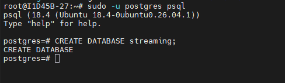

### Realizar o acesso via VsCode 
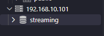

### Criar uma tabela com Filmes e Séries (30 registros)

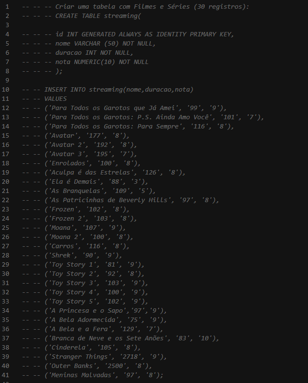

### Colunas: ID, nome, duração (minutos), nota (0 a 10)
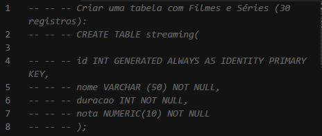

### Consultem, após a criação, somente o nome e nota dos filmes (filtro de colunas)

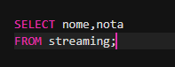
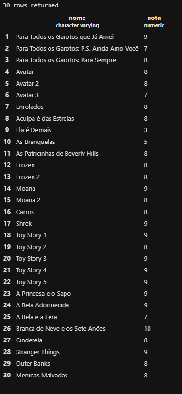

### Atualizem a nota de, pelo menos, 5 filmes (filmes que você já viu)

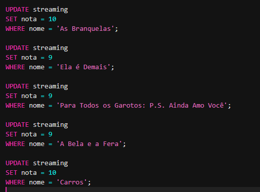
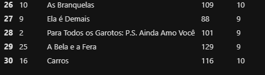

### No final, por ser uma base muito grande, o SSD do seu PC, ficou cheio. Logo, apagar os 5 filmes com avaliação mais baixa.

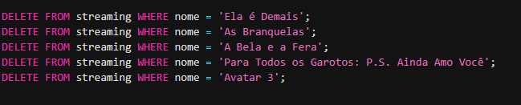
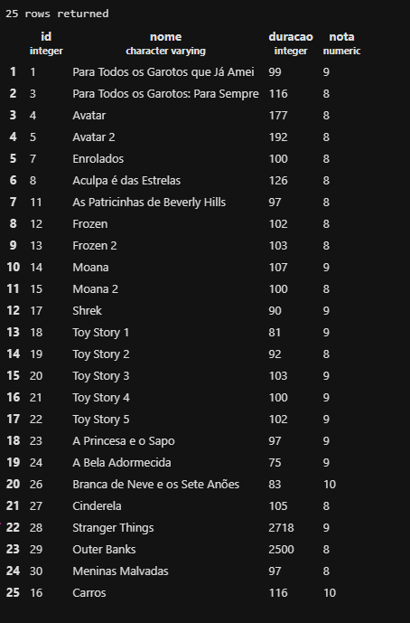


