## AULA 08 - Análise de Dados (Funções) - Revisão

> Para *contar* a quantidade de linhas presentes na tabela:
```sql
SELECT COUNT(*) FROM produtos;
```

>Para *contar* e *renomear* a tabela:
```sql
SELECT COUNT(*) AS total_registros FROM produtos;
```

> Para *filtrar* quantos produtos da tabela estão com o estoque *igual* ou *abaixo* de 5:
```sql
SELECT COUNT(*) AS produtos_baixoestoque
FROM produtos
WHERE estoque <= 5;
```

>Para filtrar quantos produtos da tabela possuem a categoria 'Perifericos':
```sql
SELECT COUNT(*) AS total_perifericos
FROM produto
WHERE categoria = 'Perifericos';
```

>É uma *FUNÇÃO*
```SQL
COUNT(*)
```

>Para exibir o maior valor:
```sql
SELECT MAX(preco) AS maior_preco
FROM produto;
```

>Para ordenar os produtos da tabela do mais caro para o mais barato:
```sql
SELECT nome,preco FROM produto
ORDER BY preco DESC;
```

>Para exibir o produto de menor valor:
```sql
SELECT MIN(preco) AS menor_valor
FROM produto;
```

>Para obter a media de preço dos produtos:
```sql
SELECT AVG(preco) AS media_precos
FROM produto;
```

>Para calcular a média de "maneira correta" (arredondada):
```sql
SELECT ROUND(AVG(preco),2) AS media_correta
FROM produto;
```

>Para exibir tudo em uma consulta:
```sql
SELECT 
MAX(preco) AS maior_preco,
MIN(preco) AS menor_preco,
ROUND(AVG(preco),2) AS media
FROM produto;
```

>Para somar a quantidade de produtos:
```sql
SELECT SUM(estoque) AS total_produtos
FROM produto;

```

>Para exibir tudo um uma tabelinha:
```sql
SELECT 
MAX(preco) AS maior_preco,
MIN(preco) AS menor_preco,
ROUND(AVG(preco),2) AS media,
SUM(estoque) AS total_produtos 
FROM produto;
```

>Para somar o total de faturamento vendendo todos os produtos da Terabyte:
```sql
SELECT SUM(preco * estoque) AS total_faturamento_por_produto
FROM produto;
```

>Para deletar todos os dados da tabela:
```sql
DELETE FROM produto;
```


### Atividade prática 07 - Análise de Dados 

#### PARTE A — CONSULTAS E FILTROS

>A1. Liste o nome e o preço de todos os produtos da categoria Monitores.

```sql
SELECT nome,preco
FROM produto
WHERE categoria = 'Monitores';
```
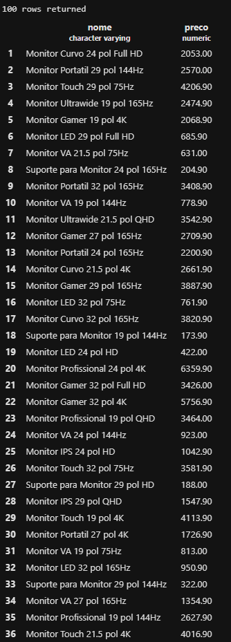

>A2. Liste todos os produtos com estoque menor que 5 unidades, mostrando nome, categoria e estoque.

```sql
SELECT nome,categoria,estoque
FROM produto
WHERE estoque < 5;
```
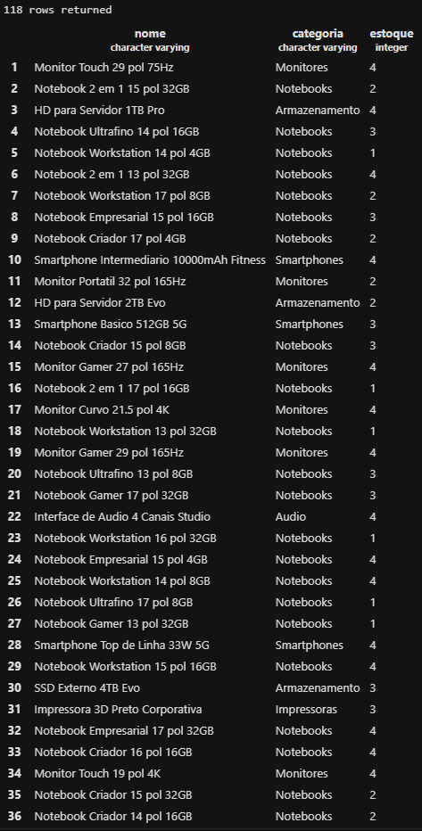

>A3. Liste os 10 produtos mais caros da loja (nome e preço), do mais caro para o mais barato.

```sql
SELECT nome,preco
FROM produto
ORDER BY preco DESC
LIMIT 10;
```
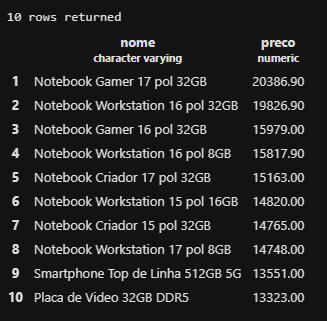

>A4. Liste os produtos da marca Logitech, ordenados por preço crescente.

```sql
SELECT * FROM produto
WHERE marca = 'Logitech'
ORDER BY preco ASC;
```
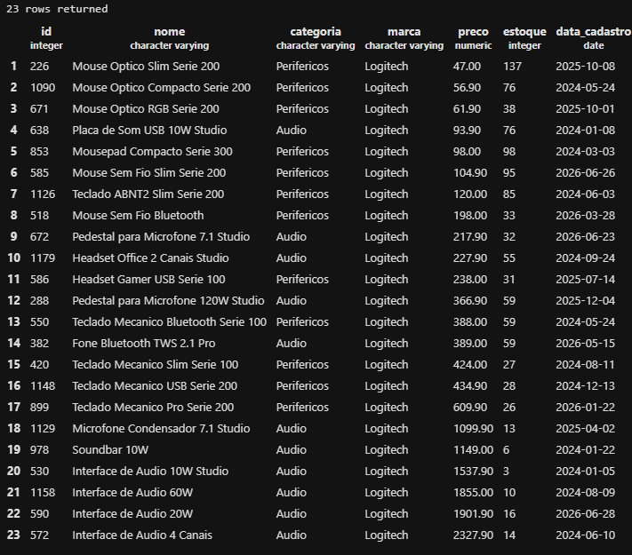

>A5. Liste os produtos com preço entre R$ 100,00 e R$ 500,00, mostrando nome e preço.

```sql
SELECT nome,preco
FROM produto
WHERE preco BETWEEN 100 AND 500;
```
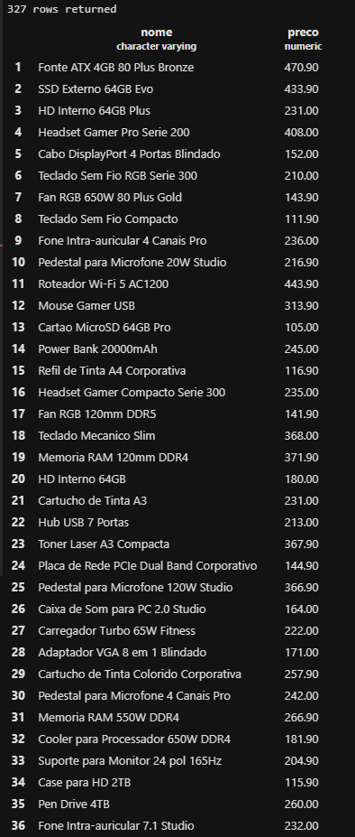

#### PARTE B — FUNÇÕES DE AGREGAÇÃO
 
>B1. Quantos produtos existem cadastrados na loja? Dê ao resultado o nome total_de_produtos.

```sql
SELECT COUNT(*) AS total_de_produtos
FROM produto;
```
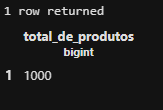

>B2. Quantos produtos estão com estoque abaixo de 10 unidades? Nomeie a coluna como produtos_em_falta.

```sql
SELECT COUNT(*) AS produtos_em_falta
FROM produto
WHERE estoque < 10;
```
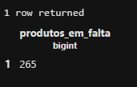

>B3. Qual o maior e o menor preço da loja? Traga os dois na mesma consulta, com os nomes maior_preco e menor_preco.

```sql
SELECT 
MAX(preco) AS maior_preco,
MIN(preco) AS menor_preco
FROM produto;
```
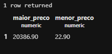

>B4. Qual o preço médio dos produtos da categoria Notebooks, arredondado para 2 casas decimais?

```sql
SELECT ROUND(AVG(preco),2) AS preco_medio
FROM produto
WHERE categoria = 'Notebooks';
```
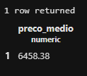

>B5. Quantas peças a loja tem no total, somando o estoque de todos os produtos? Nomeie como total_de_pecas.

```sql
SELECT SUM(estoque) AS total_de_pecas
FROM produto;
```
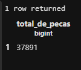


#### PARTE C — PAINEL E CÁLCULOS

>C1. Monte um painel resumo em uma única consulta, retornando de uma vez: quantidade de produtos, preço médio (2 casas decimais), maior preço, menor preço e total de peças em estoque. Todas as colunas devem ter nomes compreensíveis para o gerente.

```sql
SELECT
COUNT(*) AS quantidade_de_produtos,
ROUND(AVG(preco),2) AS preco_medio,
MAX(preco) AS maior_preco,
MIN(preco) AS menor_preco,
SUM(estoque) AS total_de_pecas
FROM produto;
```
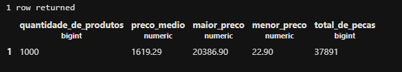

>C2. O valor imobilizado de um produto não está gravado na tabela: ele precisa ser calculado (preço x estoque). Crie a coluna calculada valor_em_estoque e mostre os 5 produtos com maior valor imobilizado, exibindo nome, preço, estoque e o valor calculado.

```sql
SELECT nome,preco,estoque, (preco * estoque) AS valor_em_estoque
FROM produto
ORDER BY valor_em_estoque DESC
LIMIT 5;
```
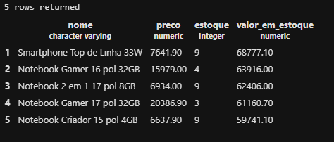

>C3. Compare o resultado de C2 com o produto mais caro que apareceu em A3. É o mesmo item? Escreva duas linhas explicando o que essa comparação revela sobre o estoque da loja.

> - Não, não é o mesmo produto.
O produto mais caro é o Notebook Gamer 17 pol 32GB, mas o maior valor em estoque é do Smartphone Top de Linha 33W. Isso mostra que a quantidade de produtos em estoque também influencia no valor total.