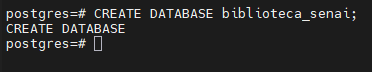
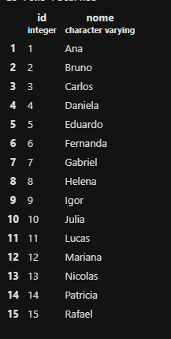
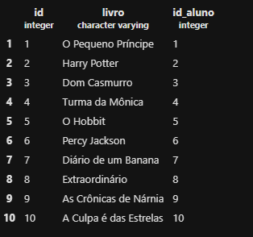
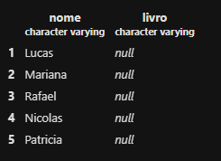

# Atividade prática 11 - Relacionamento entre tabelas



## PARTE 1 – MONTAR O BANCO (copie e execute)

> Criaçaõ da tabela `alunos`
```sql
CREATE TABLE alunos (
    id SERIAL PRIMARY KEY,
    nome VARCHAR(100) NOT NULL
);
```
> Crição da tabela `emprestimos`
```sql
CREATE TABLE emprestimos(
    id SERIAL PRIMARY KEY,
    livro VARCHAR(50) NOT NULL,
    id_aluno INT REFERENCES alunos(id)
);
```

> Aicionei 15 alunos na tabela `aluno`
```sql
INSERT INTO alunos (nome) VALUES
('Ana'),
('Bruno'),
('Carlos'),
('Daniela'),
('Eduardo'),
('Fernanda'),
('Gabriel'),
('Helena'),
('Igor'),
('Julia'),
('Lucas'),
('Mariana'),
('Nicolas'),
('Patricia'),
('Rafael');
```

> Adicionei 10 livros na tabela `emorestimos`
```sql
INSERT INTO emprestimos(livro, id_aluno) VALUES
('O Pequeno Príncipe', 1),
('Harry Potter', 2),
('Dom Casmurro', 3),
('Turma da Mônica', 4),
('O Hobbit', 5),
('Percy Jackson', 6),
('Diário de um Banana', 7),
('Extraordinário', 8),
('As Crônicas de Nárnia', 9),
('A Culpa é das Estrelas', 10);
```

## PARTE 2 –(escreva as consultas)

1. Mostre todos os dados de cada tabela (uma consulta para cada).
```sql
SELECT * FROM alunos;
```


```sql
SELECT * FROM emprestimos;
```


2. Usando INNER JOIN, mostre o nome do aluno e o livro que ele pegou.
```sql
SELECT alunos.nome, emprestimos.livro
FROM emprestimos
INNER JOIN alunos ON emprestimos.id_aluno = alunos.id;
```


> Quais alunos NÃO apareceram? Por quê?

> Os alunos que não apareceram foi:
> - Lucas
> - Mariana
> - Nicolas
> - Rafael
> - Patricia

> Não apareceram porque não possuem nenhum empréstimo registrado.

3. Usando LEFT JOIN, mostre TODOS os alunos e o livro de cada um.

```sql
SELECT alunos.nome, emprestimos.livro
FROM alunos
LEFT JOIN emprestimos ON emprestimos.id_aluno = alunos.id;
```


> O que apareceu na coluna livro para quem não pegou nenhum livro?

> Apareceu `null`

4. A bibliotecária quer saber quem NUNCA pegou livro.

```sql
SELECT alunos.nome, emprestimos.livro
FROM alunos
LEFT JOIN emprestimos ON emprestimos.id_aluno = alunos.id
WHERE emprestimos.id IS NULL;
```


> Escreva a consulta que mostra só esses alunos.

> O resultado será: 

> - Lucas
> - Mariana
> - Rafael
> - Nicolas
> - Patricia

5. Tente registrar um empréstimo para o aluno 50:

```sql
INSERT INTO emprestimos (livro, id_aluno) VALUES ('Turma da Mônica', 50);
```


> O que aconteceu? Por quê?

> Deu erro, porque o aluno 50 não existe na tabela `alunos`. O banco verifica se o aluno está cadastrado antes de criar o empréstimo, por isso o cadastro não foi realizado.


