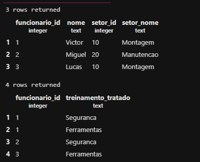

## Normalização de Banco de Dados
Objeivo: Normalizar um banco de dados com problemas de organização de registro 

### 1 FN
1- Primeiro, criamos um banco de dados:
```sql
CREATE DATABASE empresa_polly;
```

2- Criamos a tabela original:
```sql
CREATE TABLE cadastro_original (
    funcionario_id INTEGER PRIMARY KEY,
    nome TEXT,
    setor_id INTEGER,
    setor_nome TEXT,
    treinamentos TEXT
);
```

3- Inserimos os dados na tabela:
```sql
INSERT INTO cadastro_original VALUES
(1,'Victor',10,'Montagem','Seguranca;Ferramentas'),
(2,'Miguel',20,'Manutencao','Seguranca'),
(3,'Lucas',10,'Montagem','Ferramentas');
```

4- Ao realizar a primeira consulta, verificamos que o Victor está com dosi resgistros na mesma linha!

```sql
SELECT * FROM cadastro_original ORDER BY funcionario_id;
```

5- Criamos uma nova tabela com a nova a 1FN
```sql
CREATE TABLE cadastro_1fn AS 
SELECT funcionario_id,nome,setor_id,setor_nome,
    string_to_table(treinamentos, ';') AS treinamento_tratado
FROM cadastro_original;
```

6- Atribuímos o funcionario_id ao treinameno 1FN
```sql
ALTER TABLE cadastro_1fn
ADD PRIMARY KEY (funcionario_id,treinamento_tratado);
```

7- Para verificar
```sql
SELECT * FROM cadastro_1fn;
```


### 2FN

8- 
```sql
CREATE TABLE funcionarios AS
SELECT DISTINCT funcionario_id,nome,setor_id,setor_nome
FROM cadastro_1fn;
```
> O DISTINT evita copiar linhas iguais mais de uma vez. Ou seja: Os dois treinamentos o Victor viram um só.

9-O comando CREATE TABLE AS não traz as chaves primarias automaticamente, dessa forma, executamos o comando: 
```sql
ALTER TABLE funcionarios
ADD PRIMARY KEY (funcionario_id);
```

10- Criamos a tabela PARTICIPAÇÕES, trazendo apenas o ID do funcionário e os seus treinamentos.
```sql
CREATE TABLE participacoes AS SELECT funcionario_id,treinamento_tratado FROM cadastro_1fn;
```

11-Adicionamos as chaves primárias: 
```sql
ALTER TABLE participacoes
ADD PRIMARY KEY (funcionario_id,treinamento_tratado);
```

12- Adicionando as chaves estrangeira (relações entre tabelas)
```sql
ALTER TABLE participacoes
ADD FOREIGN KEY (funcionario_id) REFERENCES funcionarios (funcionario_id);
```

13-  Verificando a 2FN
```sql
SELECT * FROM funcionarios;
SELECT * FROM participacoes;
```


### 3FN
O objetivo é separar os setores


1- Criamos a tabela setores:
```sql
CREATE TABLE setores AS SELECT DISTINCT setor_id,setor_nome
FROM funcionarios;
```

2- Adicionando a chave primária:
```sql
ALTER TABLE setores
ADD PRIMARY KEY (setor_id);
```

3- Criando a chave estrangeira
```sql
ALTER TABLE funcionarios
ADD FOREIGN KEY (setor_id) REFERENCES setores(setor_id);
```

4- Correção do errona hora de criar a tabela:
```sql 
ALTER TABLE funcionarios
ALTER COLUMN setor_id SET NOT NULL;
```

5-  Apagamos a coluna setor_nome, uma vez que tiramos essa informação esa informação da tabela funcionarios 3FN.
```sql
ALTER TABLE funcionarios
DROP COLUMN setor_nome;
```

6- Consulta as tabelas novas: 
```sql
SELECT * FROM funcionarios;
SELECT * FROM participacoes;
SELECT * FROM setores;
```


7- Vantagem para atualizar treinamentos, funcionários, setores, etc...
```sql
UPDATE setores
SET 